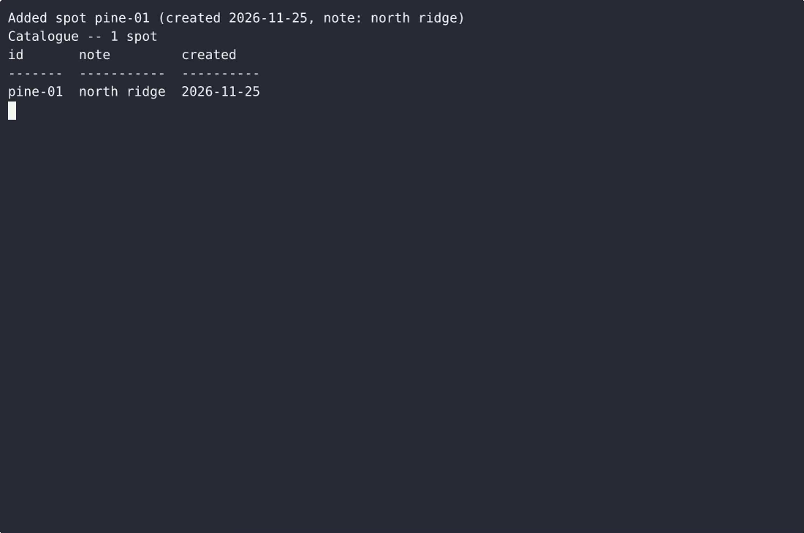
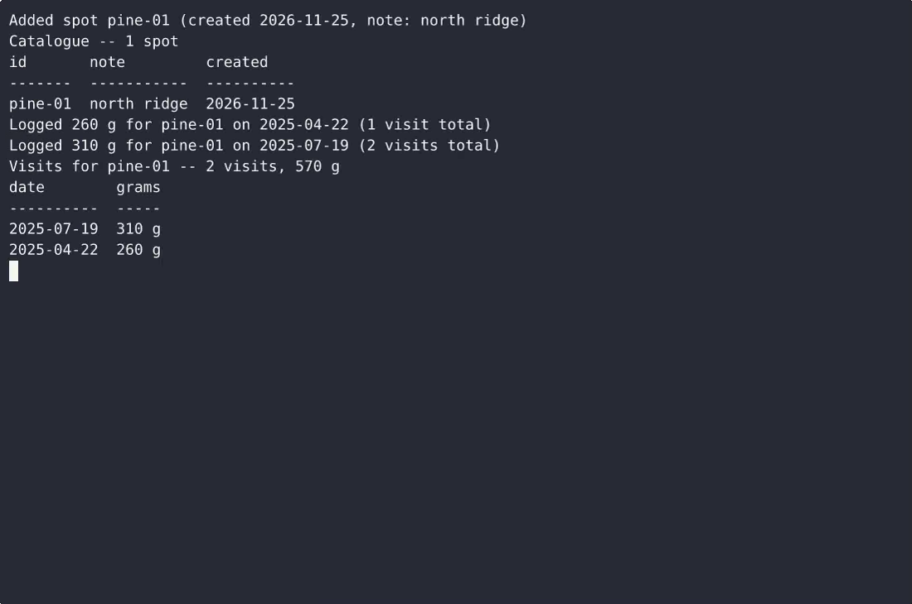

# Tarpitch — complete Full-stack app command-line tool example app

Need a self-hosted command-line tool? **Tarpitch** is the open-source answer: a Full-stack app project you can clone, run, and own. Tarpitch is a single-file, standard-library-only Python CLI that catalogues pine resin tapping spots, logs the resin yield of each tree visit, and charts seasonal flow totals as an ASCII bar chart over a local JSON file. Every Tarpitch line of code is here — no stripped demo, no paywalled features. Apache-2.0-licensed; [remix Tarpitch on cenius.ai](https://cenius.ai/marketplace/p/tarpitch?ref=gh&utm_campaign=tarpitch-webapp) for a bespoke custom version.


[](LICENSE)  [](https://cenius.ai)

[](https://cenius.ai/marketplace/p/tarpitch?ref=gh&utm_campaign=tarpitch-webapp)

> **▶ [Open & edit in cenius.ai](https://cenius.ai/marketplace/p/tarpitch?ref=gh&utm_campaign=tarpitch-webapp)** — one click to an editable workspace: describe changes in plain English, get an instant preview, one-click deploy and host. Modifications made on the platform come with full rebrand & relicense rights.

_Local clone? See [Quick start](#quick-start) below. cenius.ai is the zero-setup path._

## Demo


▶ **[Video walkthrough](https://cenius.ai/marketplace/p/tarpitch?ref=gh&utm_campaign=tarpitch-webapp)** — see the app in action on the cenius.ai project page · [MP4 file](.github/media/demo.mp4)

## Screenshots

 

## Quick start

```bash
./install.sh   # installs dependencies + seeds demo data
```

See [`INSTALL.md`](INSTALL.md) for full setup and usage instructions.

## Architecture

Everything runs out of the box: a Full-stack app codebase (28 files). Run `./install.sh` once to install packages and populate demo data — the app is ready to use immediately after. Top-level layout: `tests/`. Step-by-step setup guide: [`INSTALL.md`](INSTALL.md).

## Features

- Catalogue tapping spots
- Log yield per tree visit
- Chart seasonal flow totals

## Usage guide

A walkthrough of every command and every state it can print. Commands are shown
as `tarpitch ...`; prepend `python3 tarpitch.py` if you did not install the
console script.

### The three screens

| Screen | Command | States |
| ------ | ------- | ------ |
| Spot catalogue | `tarpitch spots list` | empty hint, populated table, rejected add |
| Visit log | `tarpitch visits list <spot>` | empty hint, populated table, unknown spot |
| Seasonal flow | `tarpitch report seasons [--spot <id>]` | populated chart, empty hint, unknown spot |

### 1. Spot catalogue

Add your first tapping spot:

```bash
$ tarpitch spots add pine-01 --note "north ridge"
Added spot pine-01 (created 2025-03-18, note: north ridge)
```

The `created` date is captured automatically as today's ISO date. Ids are
trimmed and must be unique.

```bash
$ tarpitch spots list
Catalogue -- 3 spots
id       note         created
-------  -----------  ----------
pine-01  north ridge  2025-03-18
pine-02  south slope  2025-03-18
pine-03  creek bend   2025-03-19
```

Empty catalogue (the hint is copyable as-is):

```bash
$ tarpitch spots list
No spots in the catalogue yet.
Add your first tapping spot:
  tarpitch spots add pine-01 --note "north ridge"
```

Rejected ids -- one line on stderr, exit code 2, nothing stored:

```bash
$ tarpitch spots add pine-01
error: spot id already exists: pine-01
$ tarpitch spots add "   "
error: spot id cannot be blank; use an id such as pine-01
```

### 2. Visit log

One entry per tree visit: the date and the grams of resin collected.

_Full guide: [`USAGE.md`](USAGE.md)_

## FAQ

### How do I run Tarpitch on my own server?

It runs entirely on your own machine. Clone, run `./install.sh`, and follow [`INSTALL.md`](INSTALL.md) — the whole stack is in this repo, no external dependencies required.

### Is it OK to ship Tarpitch as part of a product?

The code is under the Apache-2.0 license, which allows commercial use without restriction. You can build, sell, and deploy it freely. Full text: [LICENSE](LICENSE).

### Is Tarpitch editable without a developer?

Yes — [load it on cenius.ai](https://cenius.ai/marketplace/p/tarpitch?ref=gh&utm_campaign=tarpitch-webapp), describe the change in plain English, and you get back a fresh build with your modification applied.

### Which technology stack does Tarpitch use?

The app is built with Full-stack app. What you see in this repo is the full production source, demo data included. Highlights include catalogue tapping spots.

### Is it possible to white-label Tarpitch for a client?

Yes. The MIT license lets you remove the original branding and ship under your own name. For a guided approach, [remix it on cenius.ai](https://cenius.ai/marketplace/p/tarpitch?ref=gh&utm_campaign=tarpitch-webapp): you get a fresh build with full rebrand and relicense rights.

## License & rebranding

Released under the [Apache License 2.0](LICENSE) (© 2026 Cenius AI) — free for personal and commercial use. The Cenius name/logo are trademarks (see NOTICE).

**Need a customized version?** [Remix this app on cenius.ai](https://cenius.ai/marketplace/p/tarpitch?ref=gh&utm_campaign=tarpitch-webapp) — modifications made on the platform come with **full rebrand & relicense rights** over your derivative.

## Built with cenius.ai

This entire application — code, design, seeded demo data — was generated on **[cenius.ai](https://cenius.ai)** from a plain-English description.

- 🚀 [Build your own app on cenius.ai](https://cenius.ai)
- 🎛️ [Remix Tarpitch on the marketplace](https://cenius.ai/marketplace/p/tarpitch?ref=gh&utm_campaign=tarpitch-webapp) — open it in a workspace, prompt for changes, and ship your own version.

More open-source apps: [the Cenius-ai catalog](https://github.com/Cenius-ai) · [showcase index](https://github.com/Cenius-ai/showcase)
